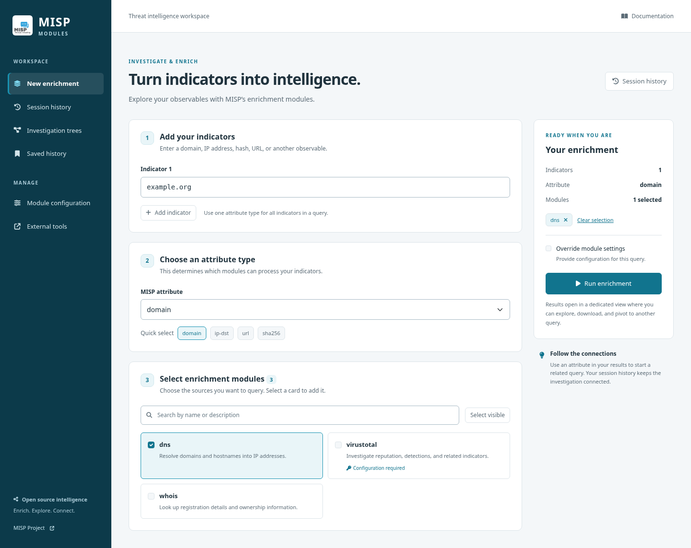
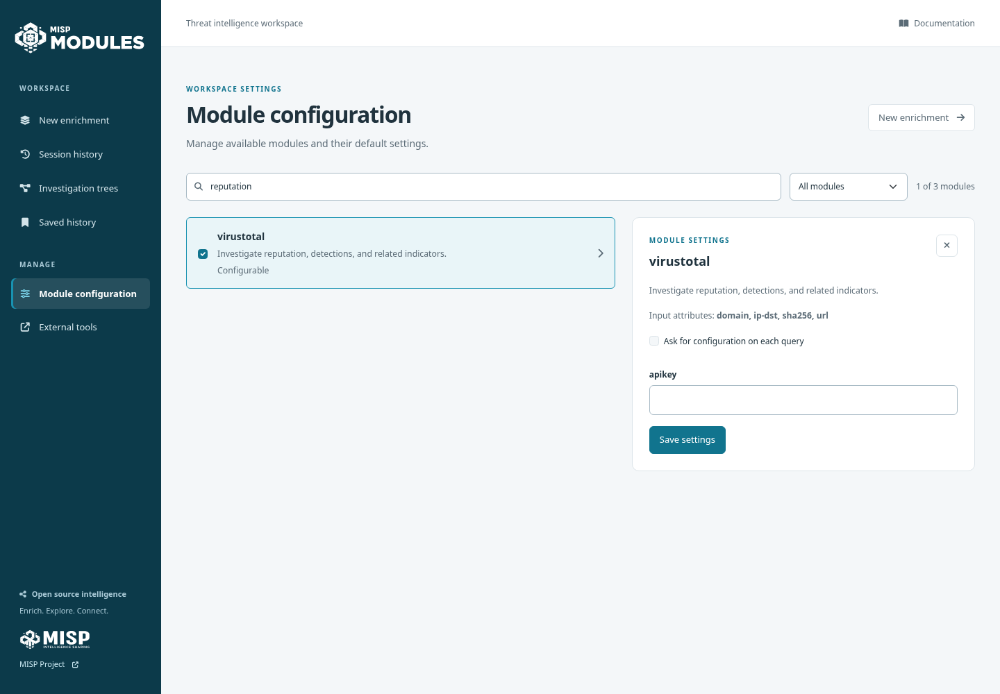
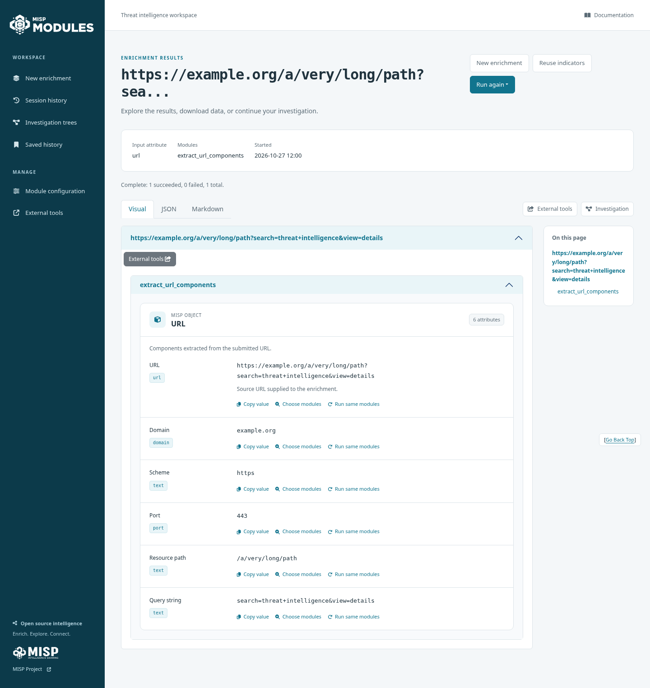
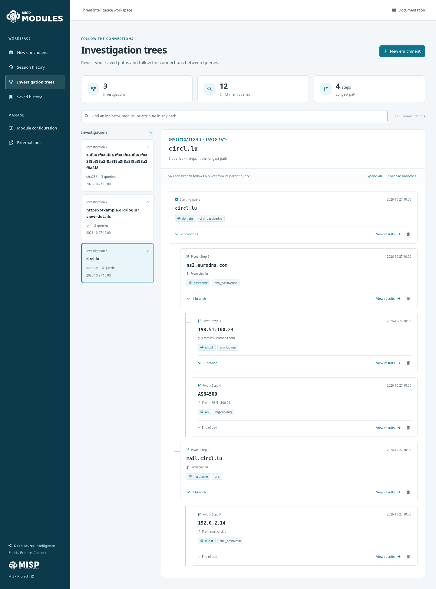
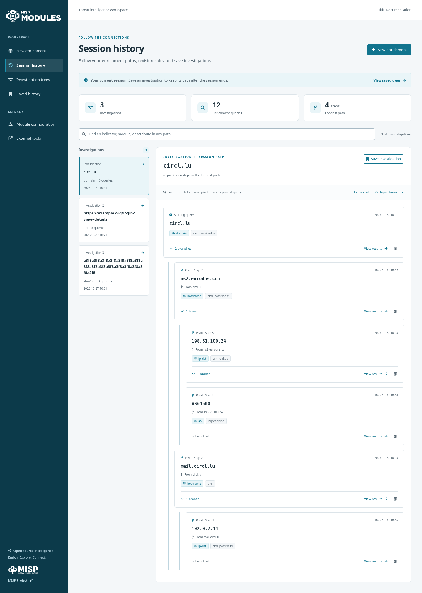

# Website interface

The website uses the existing Flask, Vue 3, Bootstrap 5, and locally bundled
Font Awesome assets. It needs no additional production dependencies, remote fonts,
CDN requests, or database migration.





[View the mobile layout](home_mobile.png). Screenshots use the isolated sample
catalogue from the browser checks.

## Official branding and visual results

The application uses the official MISP Modules wordmark and favicon from
[MISP visual identity 2.0](https://github.com/MISP/visual-identity/tree/main/2.0/misp-satellite/MISP-Modules),
alongside the updated parent MISP logo. See the [asset attribution and exact source
files](../app/static/images/README.md). The SVG artwork is bundled locally and
used without modifications, external fonts, or CDN requests.

Visual enrichment output uses separate cards for MISP objects and flat
attributes. Object properties are grouped in a definition list with readable
labels, original MISP type badges, complete values, and comments. Long indicators
wrap and multiline text retains its line breaks. Property order follows the
module response, including the backend's UI priority ordering. Missing attributes
have an explicit empty state; zero and false values remain visible.

Each value offers copying and the existing related-query actions. “Choose
modules” opens a related query with the complete value; “Run same modules” keeps
the original query's attribute type and modules. Count and datetime attributes
only offer copying, as before. Action errors appear beside the value. Indicator
values are inserted as text; delegated actions preserve them without inline
JavaScript, and related-query URLs encode reserved characters. JSON download links also
encode complete indicator values, including query strings containing `&` or `#`.



[View the visual object card on mobile](object_result_mobile.png).

## Design references

The interface follows the [MISP 3.0 Overmind theme](https://github.com/MISP/MISP/tree/3.0_wip/tools/bootstrap-themes):

- The `#1892B1` brand accent from `themes/overmind/_overmind-variables.scss` and
  `scss/_misp-colors.scss`, with a darker `#11748E` for accessible text and buttons.
- The blue-teal navigation surface, Bootstrap 5 controls, understated borders, and
  clear separation of workspace navigation from page actions.

[Vitrine's design system](https://github.com/ecrou-exact/vitrine/blob/main/docs/DESIGN_SYSTEM.md)
informs the consistent 4/8/12/16/24/32px spacing, 6/10px corner radii, quiet surfaces,
visible focus states, and content-first presentation. The host also exposes
`--vt-*` color aliases for future Vitrine components. Vitrine is a design reference;
its web components are not loaded or required by this change.

Shared tokens and styles live in `app/assets/src/css/core.css`. The tracked
`app/static/css/core.css` is generated by Vite. New page behavior lives in
`app/static/js/home.js`, `modules-config.js`, and `shell.js`; these ES modules are
served directly, like the existing history and toast modules.

## Workflows

- New enrichment: add one or more indicators, choose a MISP attribute type, search
  compatible module names/descriptions, and select modules. A summary shows the
  indicators, attribute, and selected modules before submission.
- Changing attribute type clears the module selection, preventing incompatible
  modules from being submitted. Blank indicators are omitted; an entirely blank
  query, missing attribute, missing modules, or required configuration shows an
  inline error. Pending submissions cannot be repeated.
- Modules requesting per-query configuration show their fields automatically.
  “Override module settings” also exposes settings for other selected modules.
  Only currently selected modules' requested overrides are submitted. Default
  configuration continues to be resolved by the backend.
- Module configuration: search by name, description, or input attribute; filter by
  enabled status; select a module to edit its defaults. API failures restore the
  status checkbox or leave the form editable with an error.
- History, results, login, and external tools share the navigation and visual
  tokens. Result formats support keyboard tabs; the mobile menu supports Escape
  and restores focus to its trigger.

The existing endpoint payloads, query history/pivot relationships, authentication,
and module execution semantics are preserved. This change provides a light theme.

## Investigation paths

Session history and Investigation trees use a focused path explorer. A compact
investigation list sits beside the selected path; small screens use a native
investigation picker. Overview cards show the number of investigations, total
queries, and longest path. Query cards expose the indicator, MISP attribute,
modules, timestamp, parent query, and a direct link to results.

Search matches indicators, module names, and attributes across every path. Parent
queries remain visible so a matching pivot keeps its context, and matching paths
expand automatically. Per-branch toggles and Expand all / Collapse branches help
navigate large investigations. Indentation is capped on deep paths; step labels
and parent links continue to identify each relationship. Keyboard navigation uses
ordinary links and buttons inside semantic nested lists, with explicit expanded
states on branch controls.

Session-only paths have a clear save action and a link to saved trees. Branch
removal shows an inline confirmation with the **full** subtree size, including
queries hidden by search. A successful removal reloads server state; failures
keep the existing path visible. Removing a branch changes tree membership, while
the enrichment results remain available. Session and saved trees are independent.

The removal endpoints accept an optional `root_id` query parameter, used by the
new interface to scope a mutation to the selected investigation. Calls without
this parameter remain supported. Missing nodes return HTTP 404. The underlying
traversal searches all sibling branches, preserves the root when deleting a
child, persists nested session changes, and clears a deleted current-query
pointer. Repeated saves compare the stored topology and do not create duplicates.
No database migration is required.





[View the mobile investigation layout](investigation_mobile.png). These are
illustrative fixture paths, not observed DNS or threat intelligence data.

## Build assets

```sh
cd website/app/assets
npm ci
npm run build:static
```

Commit both the source CSS and the generated static CSS. This build also copies
the vendor assets from the versions in `package-lock.json`.

## Browser regression checks

In a Python environment containing the website's dependencies:

```sh
python -m pip install playwright
python -m playwright install chromium
python -m unittest discover -s website/tests -p '*_checks.py' -v
```

For a system Chromium, set `CHROMIUM_EXECUTABLE=/usr/bin/chromium` instead of
installing a Playwright browser. Tests start the real Flask application with a
fresh temporary SQLite database, sample module catalogue, and fixture enrichment
execution. They do not need the misp-modules daemon, credentials, or Internet
access. They cover request payloads and CSRF, validation, configuration, selection
reset, network failures/retry, duplicate submissions, settings save/toggle failures,
login/navigation, result/error grouping, query parent relationships, copy and
related-query actions, official brand assets, safe text rendering, object cards,
and layouts at 320, 768, and 1440 pixels. History checks also cover populated and
12-level paths, ancestor-preserving search, save/update, filtered root removal,
API error/retry, scoped mutations, sibling preservation, and session persistence.

Optional screenshots and automated accessibility checks:

```sh
npm install --prefix /tmp/misp-ui-a11y axe-core
AXE_SCRIPT_PATH=/tmp/misp-ui-a11y/node_modules/axe-core/axe.min.js \
UI_SCREENSHOT_DIR=/tmp/misp-ui-screenshots \
python -m unittest discover -s website/tests -p '*_checks.py' -v
```

The dedicated `Test website interface` GitHub Actions workflow builds the assets,
checks that generated files match their sources, runs these checks, and uploads
interface screenshots. The browser suite uses a separate filename so the root
Python package tests do not require browser dependencies.

The axe scan checks WCAG 2 A/AA and WCAG 2.1 AA tags on the query builder,
configuration, history, result, external tool, and login pages. It supplements
keyboard and responsive checks; it does not establish full accessibility
conformance.

For interactive review with the same isolated fixture data:

```sh
python website/tests/preview_server.py --port 7010
```

Open `http://127.0.0.1:7010`. For populated history review, visit
`http://127.0.0.1:7010/history_tree?sample=saved` (session and saved paths) or
`http://127.0.0.1:7010/history_session?sample=session` (unsaved session paths).
Sample paths initialize once per browser session; a fresh browser context resets
the fixture data. These options exist only in the test preview server.

Enrichments return the stored sample result; no module is executed. To check real execution, use a normally initialized website with its
misp-modules daemon running. The redesign was also checked this way using the
`extract_url_components` module on an example.org URL, including results and JSON
download controls.
